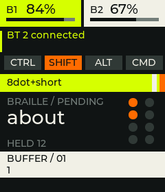
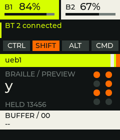
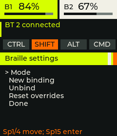

# Graphic dashboard direction

The dashboard uses original graphic layouts inspired by modern Marathon's bold colour blocking and utilitarian typography. Two concepts were explored with the built-in image-generation tool; the lime, ink, warm white and orange direction was selected for implementation.

The generated concepts are design exploration. The firmware uses native LVGL graphics and real state, with no generated text or bitmap dependency. Actual 240×280 previews in this directory are rendered from the production screen source.

  

Regenerate all twelve normal and edge-case previews with:

```sh
python3 scripts/preview-braille-dashboard.py --lvgl /path/to/pinned/lvgl
```

The harness also checks editor exit, battery availability, left/right modifier mapping and physical braille-dot placement. The preview uses the actual screen implementation; platform state is supplied by fixtures. Hardware readability and runtime behaviour still need an on-device check.

## Design priorities

- Two battery gauges with numeric readings and explicit unavailable states.
- A clear transport and connection band, including preferred transport when fallback is active.
- Modifier chips that light when held.
- A bright current-mode band and a large translated preview beside the physical eight-dot cell.
- A separate buffer area and readable settings/editor states.
- Sharp shapes and a restrained palette suitable for the display and its memory budget.

## Concept prompts

### Lime / orange

Use case: ui-mockup. Create a polished concept board of an original tiny 240x280 pixel portrait keyboard dongle dashboard, enlarged crisply. Inspired by the graphic design of Bungie's modern Marathon: acid lime, near-black, warm white, vivid orange, stark geometric color blocking, bold condensed typography and precise utilitarian signal graphics. NOT a game HUD, no game logos. One single flat screen filling the image, no device frame. At this small display size use few large readable elements, no decorative microtext. Header has two graphical segmented battery gauges labelled B1 84% and B2 67%. Connection band BT 2 CONNECTED with a strong signal icon. Four modifier chips CTRL SHIFT ALT CMD, only SHIFT lit orange. Mode strip 8DOT+SHORT. Hero area contains large lowercase 'about' and an actual eight-dot braille cell with two columns of four dots, dots 1 and 2 illuminated (left column top two), other six dim. A tiny HELD caption and '12'. Bottom buffer area labelled BUFFER 1 with one small braille cell showing only dot 1 lit. Convey adventurous editorial sci-fi industrial design using flat sharp rectangles and circles that could be implemented in LVGL, high legibility, generous hierarchy, substantial colour panels, no gradients, no shadows, no extra metrics.

### Orange / cyan

Use case: ui-mockup. Explore a second distinct original keyboard dongle dashboard, single flat portrait 240x280 proportion screen enlarged, no hardware. Graphic design inspiration modern Bungie Marathon: bold utilitarian Swiss sci-fi typography, striking graphic panels, hard geometric wayfinding. Alternative palette burnt fluorescent orange as dominant header, cyan indicators, bone white and nearblack. Tiny embedded screen so readable sparse hierarchy, implementable with rectangles/circles and fonts. Top dual battery gauges B1 84%, B2 67%. BT 2 CONNECTED. Modifier chips CTRL SHIFT ALT CMD with SHIFT active. Mode 8DOT+SHORT. Main huge lowercase 'about', 2x4 braille dot graphic dots1+2 lit left top two. Bottom BUFFER 1 with dot1 cell. Original dashboard, no logos, no game metrics, no texture, no gradients, no microscopic ornamental labels. More visually adventurous asymmetry than generic text dashboard.
